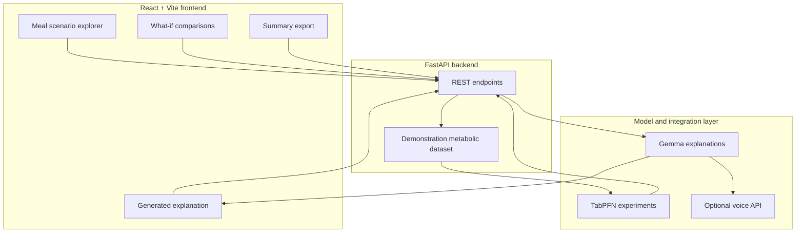

<div align="center">
  <h1>GlucoPulse</h1>
  <p><strong>An open-source metabolic data exploration and meal-scenario prototype.</strong></p>
  <p>Explore glucose-curve visualizations, compare hypothetical interventions, and prepare structured summaries for discussion with a qualified healthcare professional.</p>
  <p>
    
    
    
    
  </p>
</div>

---

GlucoPulse explores how tabular machine-learning models, language models, and interactive visualizations might be combined in a metabolic-data application. The project includes meal-scenario exploration, what-if comparisons, generated explanations, optional voice output, and report-style exports.

> **Important health disclaimer:** GlucoPulse is an experimental software project, not a medical device or a clinically validated prediction system. Forecasts, scenario comparisons, thresholds, generated explanations, and example metrics are for software demonstration and educational exploration only. They must not be used to diagnose, treat, or make medication or dietary decisions. Consult a qualified healthcare professional for personal medical guidance.

## Architecture



## Features

- **Glucose-curve visualization** — explore model-generated curves and example time-series outputs.
- **Hypothetical intervention studio** — compare scenarios such as baseline meals, movement, fiber, food sequencing, and combinations. Results depend on the model and assumptions; they do not demonstrate clinical effectiveness.
- **Tabular-model experiments** — integrates Prior Labs TabPFN components for experimentation with structured inputs.
- **Plain-language explanations** — uses Google Gemma to generate summaries from application-provided context. Generated text can be incomplete or incorrect.
- **Optional voice guidance** — supports an ElevenLabs integration for spoken output when configured.
- **Report-style export** — prepare a structured summary that can be reviewed with a qualified professional.
- **Configurable integrations** — model and voice services can require credentials and network access depending on the selected setup.

## Technology stack

| Layer | Technology |
|---|---|
| Frontend | React, Vite, Tailwind CSS, Recharts |
| Backend | Python, FastAPI |
| Tabular modeling | Prior Labs TabPFN |
| Language model | Google Gemma |
| Voice | Optional ElevenLabs integration |
| Deployment | Optional Render blueprint |

## Quickstart

### Prerequisites

- Python 3.10+
- Node.js 18+
- Git

### 1. Clone the repository

```bash
git clone https://github.com/kishorekrrish3/glucopulse.git
cd glucopulse
```

### 2. Install backend dependencies

```bash
pip install -r requirements.txt
```

### 3. Build the frontend

```bash
cd frontend
npm install
npm run build
cd ..
```

### 4. Run the application

```bash
python -m uvicorn backend.main:app --host 127.0.0.1 --port 8000
```

Open [http://localhost:8000](http://localhost:8000).

Optional provider integrations can be configured using the variable names in `.env.example`. Keep credentials in a local, untracked environment file. Offline operation depends on which model assets and integrations are enabled; hosted APIs and voice providers require network access.

## Optional deployment

The repository includes a `render.yaml` deployment blueprint. Before deploying, review the services, environment variables, persistence requirements, and data flows. Do not upload real health information unless you have verified the privacy, security, and provider terms for the full configuration.

## Privacy and responsible use

- Health-related information is sensitive. Check whether each model, hosting, logging, database, and voice component processes data locally or sends it to an external service.
- Example metrics and demonstration data are not evidence of clinical accuracy.
- Model-generated explanations are not medical advice and may contain errors.
- Do not use this project to make medication, diagnosis, or treatment decisions.
- Review model licenses and external-service pricing before enabling integrations.

## Contributing

Issues and pull requests are welcome. Include reproducible steps, describe the model/data assumptions behind proposed changes, and avoid committing personal health information, credentials, or private datasets.

## License

MIT. See [LICENSE](LICENSE) for details.
